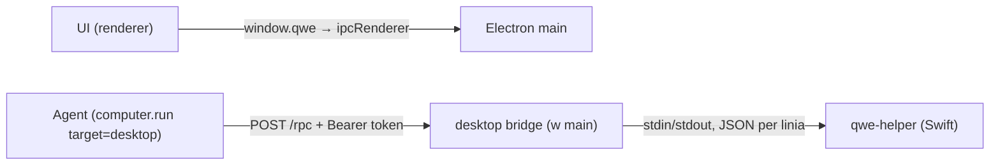

Trzy interfejsy, trzy granice zaufania:



## `window.qwe` (preload)

Jedyny most UI ↔ Electron, wyłącznie dla operacji desktopowych; dane i tak idą przez WS. W zwykłej przeglądarce `window.qwe` nie istnieje.

| Członek | Kanał IPC | Opis |
|---|---|---|
| `desktop`, `platform` | — | `true`, `process.platform` |
| `setSession(id)` | `app:set-session` | która rozmowa jest otwarta (widget idzie za nią) |
| `toggleWidget()` | `app:toggle-widget` | pokaż / schowaj widget |
| `openMain(sessionId, taskId)` | `app:open-main` | okno główne na tej rozmowie i zadaniu |
| `stopAll()` | `app:stop-all` | anuluj wszystkie aktywne zadania |
| `setTheme(t)` | `app:theme` | motyw UI → `nativeTheme` (vibrancy) |
| `resize(w, h)` | `widget:resize` | rozmiar treści widgetu |
| `focus()` / `release()` / `hide()` | `widget:focus` / `release` / `hide` | fokus i chowanie widgetu |
| `menu()` | `widget:menu` | menu kontekstowe (jak tray) |
| `dragStart()` / `drag(dx, dy)` / `dragEnd()` | `widget:drag-*` | przeciąganie z przyklejaniem do krawędzi |
| `secrets.status()` | `secrets:status` (invoke) | `{ keys: { NAZWA: { label, required?, hint, set, source: "app" \| "env" \| null, tail } }, available, home }` — **bez wartości kluczy** |
| `secrets.test(name, value)` | `secrets:test` (invoke) | test u dostawcy bez kosztów (dziś tylko Anthropic: `GET /v1/models`) → `{ ok, error?, skipped? }` |
| `secrets.set(values, restart = true)` | `secrets:set` (invoke) | zapis w pęku kluczy (pusta wartość = usuń) + restart chatu → okna się przeładowują; `{ restarted, reason?, keys }` |
| `perms.status()` | `perms:status` (invoke) | `{ screen, accessibility, helper }` |
| `perms.request(kind)` | `perms:request` (invoke) | okno zgody helpera + panel Ustawień systemowych (`screen` \| `accessibility`) |
| `on(channel, cb)` | — | subskrypcja; zwraca funkcję odpinającą |

Kanały `widget:*` main przyjmuje **tylko z okna widgetu** (`fromWidget(e)`), a `secrets:*` i `perms:*` **tylko z okna głównego** (`fromMain(e)`).

Kanały main → UI (`on`): `qwe:session`, `qwe:command`, `qwe:open-session`, `qwe:new`, `qwe:find`, `qwe:stopped`, `qwe:collapse`, `qwe:attention`, `qwe:widget-visible`, `qwe:keys` (otwórz „Klucze API”). Inne nazwy są ignorowane.

## Desktop bridge

Serwer HTTP w procesie main, na `127.0.0.1` i losowym porcie, z losowym tokenem (24 bajty hex) na uruchomienie.

| Metoda | Ścieżka | Opis |
|---|---|---|
| `GET` | `/health` | `{ ok: true }` (bez tokena) |
| `POST` | `/rpc` | `Authorization: Bearer <token>`, body `{ cmd, args }` → `{ ok, result }` albo `{ ok: false, error }`; zły token → 401 |

Jak agent go znajduje: env `QWE_DESKTOP_URL` + `QWE_DESKTOP_TOKEN` (gdy chat/agent startują z Electrona) albo plik `data/desktop-bridge.json` `{ url, token, pid }` (mode `0600`) — gdy chat wstał wcześniej, np. `qwe dev` w terminalu.

Most dokłada to, czego agent nie zna: **który ekran** (aktywny albo wybrany w trayu), **czego nie fotografować** (widget; okno główne simbot zostaje na zrzucie) i znacznik, gdy na wierzchu jest sam simbot.

## Protokół qwe-helper

Jedna linia JSON na wiadomość:

```json
→ {"id":1,"cmd":"observe","args":{"maxSide":1400,"quality":0.6,"maxElements":90}}
← {"id":1,"ok":true,"result":{ … }}
← {"id":1,"ok":false,"error":"…"}
```

| Komenda | Argumenty | Wynik / efekt |
|---|---|---|
| `ping` | — | `{ pong, pid }` |
| `permissions` | — | `{ screen, accessibility }` |
| `request` | `{ kind: screen \| accessibility }` | systemowe okno zgody |
| `displays` | — | `[{ id, frame, scale, main }]` (punkty, globalnie) |
| `frontmost` | — | `{ app, bundleId, pid, window, frame, displayId }` |
| `observe` | `{ display?, maxSide?, quality?, maxElements?, excludePids? }` | frontmost + ekran + zrzut (JPEG base64) + elementy AX aktywnego okna + tekst |
| `click` | `{ x, y, button?, count? }` | punkty globalne |
| `move` / `drag` | `{ x, y }` / `{ x, y, toX, toY }` | mysz |
| `scroll` | `{ x?, y?, dx?, dy? }` | przewijanie |
| `type` | `{ text }` | wpisywanie |
| `key` | `{ combo: "cmd+shift+n" }` | skrót (cmd, shift, alt/option, ctrl, fn) |
| `press` / `focus` / `setValue` | `{ element[, value] }` | akcje Accessibility (fallback `press`: klik w środek) |
| `openApp` / `openURL` | `{ name \| bundleId }` / `{ url }` | uruchom aplikację / otwórz adres |

Każde zdarzenie generowane przez helpera ma znacznik w `eventSourceUserData` (`0x51E1`) — da się je odróżnić od ruchów usera.
