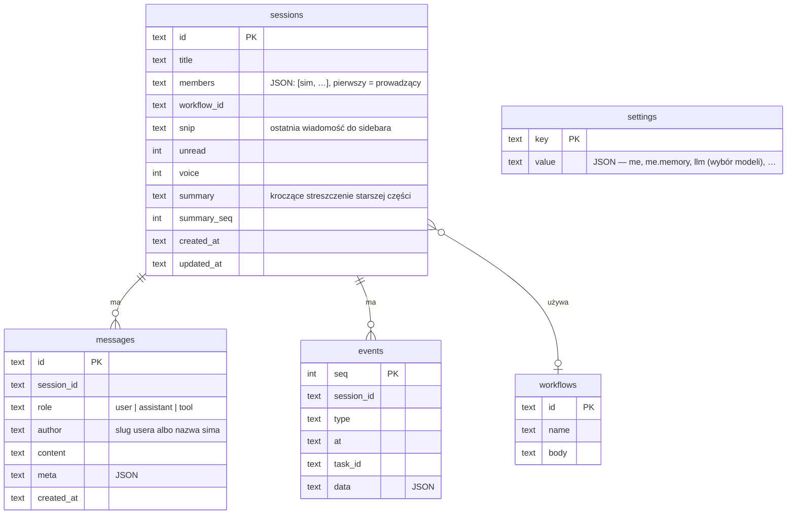

## Na dysku

```
data/                         QWE_DATA_DIR (domyślnie ./data, w .gitignore)
├── chat.db (+ -wal, -shm)    SQLite chatu: rozmowy, wiadomości, eventy, workflowy, ustawienia
├── agent-events.jsonl        append-only log eventów agenta
├── screenshots/              zrzuty z computer.run (shot_<id>.jpg|png), max 400 w indeksie
├── sessions/<id>/files/      folder plików rozmowy (upuszczone, wklejone, wrzucone w Finderze); usuwany z rozmową
├── browser-profile/          trwały profil Chromium (cookies, sesje, karty)
├── mcp.json                  serwery MCP (format mcpServers, 0600 — sekrety); pisze chat
├── mcp-catalog.json          co serwery wystawiają (narzędzia, zasoby, prompty); pisze agent, czyta chat
└── desktop-bridge.json       adres + token mostu desktopowego (zapisuje Electron)

agents/<name>/                QWE_AGENTS_DIR (domyślnie ./agents, poza gitem) — jeden folder = jeden sim; przykład: examples/kucharz
├── AgentManifest.yaml        tożsamość, capability, model, wygląd, pamięć
├── persona.md                kim jest i jak mówi
├── memory.md                 fakty (jedna linia = jeden fakt: "- 2026-11-02 · …")
├── skills/*.md               skille (frontmatter + markdown)
└── plugins/<cap>/            lokalne capability (opcjonalnie)

~/Library/Application Support/simbot/desktop.json   ustawienia desktopu (widget, tray, ekran agenta)
```

`data-test/` to osobny katalog danych do testów (też w `.gitignore`).

## SQLite (`data/chat.db`)

Baza przez wbudowane `node:sqlite`, migracje przez dokładanie kolumn (stare bazy zostają czytelne).



Pełny schemat i migracje: `apps/chat/src/store.ts`. W tabeli `sessions` są też kolumny recapu (podsumowanie rozmowy do `memory.search`).

### Co trafia do `events`

Nie wszystko. Chat zapisuje to, co UI odtwarza jako karty po reloadzie:

- z agenta: `task.*`, `plan.*`, `step.*`, `tool.*`, `web.started/completed`, wybrane `computer.*` (bez szumu obserwacji co krok);
- **nie** zapisuje: `say.*`, `voice.*`, `user.level`, `agent.state` i innych częstych eventów (lista `NO_PERSIST` w `session.ts`).

## Kontekst modelu

Trzy zasady z `apps/chat/src/context.ts`:

1. **Wyniki narzędzi w całości tylko w bieżącej turze.** Starsze → skrót (lista źródeł albo początek raportu, 400 znaków). Pełne zostają w bazie i w UI.
2. **Kroczące streszczenie.** Gdy niestreszczona część urośnie ponad `QWE_CTX_TRIGGER_CHARS` (40 000 znaków ≈ 12k tokenów), najstarszy kawałek — poza ostatnimi `QWE_CTX_KEEP` (12) wiadomościami — idzie do streszczenia tanim modelem, w tle. Bezpiecznik: maks. 160 wiadomości.
3. **Stały początek historii** → cache promptu obejmuje też historię, nie tylko prompt systemowy.
4. **Pliki w treści tylko w turze, w której przyszły** (w budżecie tokenów); w kolejnych turach odnośnik `[plik w folderze rozmowy: …]`. Zob. [Pliki rozmowy](/capabilities/files/).

## Pamięć: trzy warstwy

| Warstwa | Gdzie | Kto pisze | Kto widzi |
|---|---|---|---|
| Fakty o userze | `settings["me.memory"]` | automatycznie po turze; edycja w UI (`PUT /api/me/memory`) | wszystkie simy |
| Notatki sima | `agents/<name>/memory.md` | automatycznie po turze (`memory.enabled`, `max`); edycja w UI | tylko ten sim |
| Poprzednie rozmowy | `sessions` (recap, summary) + `messages` | recap po 90 s ciszy | każdy sim przez `memory.search` |

Migawka pamięci w prompcie odświeża się po 5 minutach bezczynności (cache i tak wygasł). Szczegóły: [Pamięć](/capabilities/memory/).
