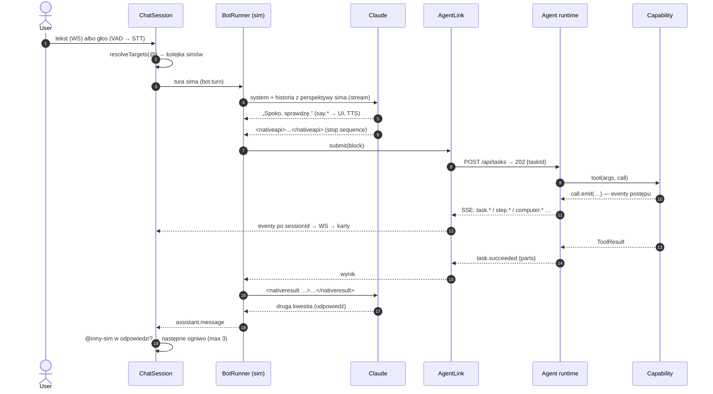
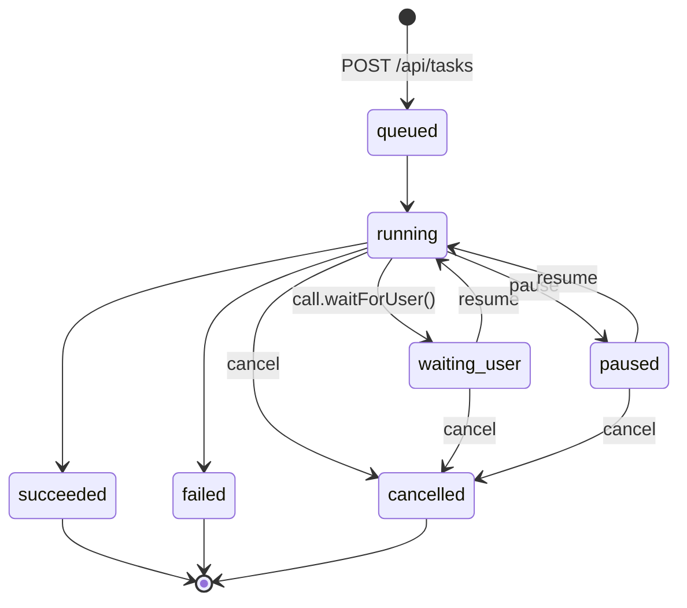
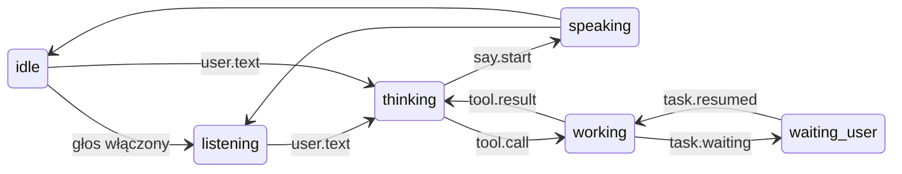

## Od wiadomości do odpowiedzi

### 1. Dispatch: kto odpowiada

`ChatSession` przepuszcza tekst przez `resolveTargets()` z [`mentions.ts`](/contracts/mentions/):

- bez `@` → odpowiada **prowadzący** (pierwszy członek rozmowy);
- `@sim` / `@sim.task` → wskazane simy, po kolei;
- `@user` → event `mention.user` (toast / powiadomienie), nikt nie odpowiada;
- `@sim` spoza rozmowy → `mention.absent`, UI proponuje „dodaj”.

Każdy sim może w odpowiedzi zawołać następnego (`@audytor sprawdź sumy`). Łańcuch ma limit **3 ogniw** po wiadomości usera (`MAX_CHAIN`).

:::note[Podczas pracy komputera]
Kiedy rozmowa jest w stanie `working` (computer task), wypowiedzi głosowe **nie idą do LLM** — trafiają do command routera (`matchVoiceCommand`): „zatrzymaj komputer”, „wznów”, „anuluj zadanie”, „przejmuję kontrolę”. Zob. [Komendy głosowe](/components/core/#command-router).
:::

### 2. Tura sima (BotRunner)

`BotRunner` buduje historię **z bazy przy każdej turze**, z perspektywy tego sima:

| Wpis w bazie | Co widzi sim |
|---|---|
| wiadomość usera | `user` |
| moja odpowiedź | `assistant` (pełny tekst z blokiem) |
| odpowiedź innego sima | `user`, jako `@nazwa: tekst` (bez bloków) |
| mój wynik narzędzia | `user` (`<nativeresult>`) — w całości tylko w bieżącej turze, starsze skrócone |
| cudzy wynik narzędzia | pominięty |

Na początek historii trafia kroczące **streszczenie** starszej części rozmowy (jeśli jest). Początek historii zmienia się rzadko, więc łapie się w cache promptu. Szczegóły: [Dane i pamięć](/architecture/data/#kontekst-modelu).

Strumień z modelu przechodzi przez `ToolStreamParser`: tekst przed `<nativeapi>` leci na bieżąco jako `say.*` (UI i TTS), a blok jest zbierany do końca. Model ma `stop_sequences: ["</nativeapi>"]`. Jedna tura może mieć do **3 wywołań** narzędzi z rzędu (`MAX_HOPS`).

### 3. Task w agencie

- **direct** — narzędzia z bloku wywoływane po kolei; wynik = lista `parts`.
- **plan** — [`executePlan()`](/contracts/nativeapi/#plan): kroki bez `after` równolegle, kroki z niespełnioną zależnością → `skipped`, anulowanie zachowuje to, co już zrobione.
- `checkpoint()` między krokami capability realizuje pauzę i anulowanie.
- Taski z **różnych** rozmów biegną równolegle; o zasoby (np. jedna przeglądarka) dba capability.

### 4. Wynik wraca do modelu

`AgentLink.submit()` czeka na terminalny event (`task.succeeded | failed | cancelled`) i oddaje wynik. `BotRunner` opakowuje go w `<nativeresult name="…" status="…">` i robi drugą rundę z modelem — sim mówi, co znalazł.

## Stany rozmowy

Rozmowa jako całość ma stan (`agent.state`), który napędza kropkę, widget i chip w sidebarze:

Half-duplex: kiedy sim mówi, VAD jest wyciszony. `Esc` / `user.interrupt` przerywa mowę (`voice.abort`).

## Po turze (w tle)

- **Pamięć** — tani model wyciąga fakty z tury do `memory.md` sima i do wspólnej pamięci o userze → event `memory.saved`.
- **Streszczenie** — gdy niestreszczona część rozmowy przekroczy ~40k znaków, najstarszy kawałek idzie do streszczenia.
- **Recap** — po 90 s ciszy rozmowa dostaje krótkie podsumowanie (do `memory.search`), czasem z propozycją nowego tytułu.

Zob. [Pamięć](/capabilities/memory/).
