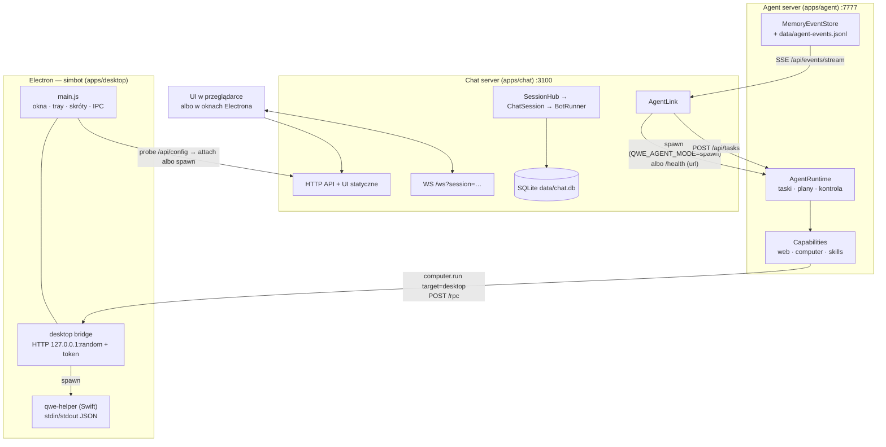
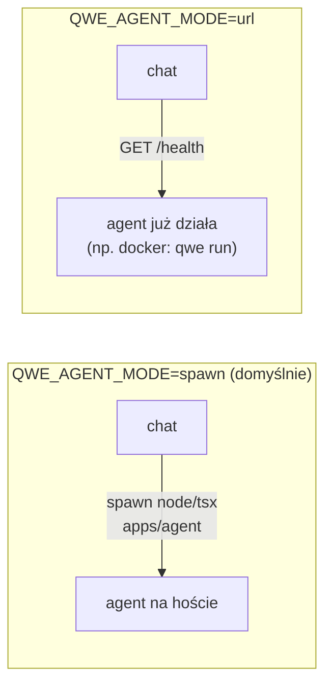

Simbot to **kilka niezależnych procesów** połączonych HTTP, SSE i WebSocketem. Każdy da się uruchomić osobno (`qwe chat`, `qwe agent`) i każdy przeżyje zamknięcie okna UI.

## Mapa procesów

## Kto kogo uruchamia

| Proces | Startuje go | Jak |
|---|---|---|
| Chat server | `qwe dev` / `qwe chat` / Electron | `tsx` na źródłach (dev) albo `node dist/index.js` (`qwe up`). Electron najpierw sprawdza `GET /api/config` — jeśli pod portem siedzi już chat qwe, **podpina się** zamiast startować drugi. |
| Agent server | Chat (`AgentLink.ensure()`) | **Leniwie** — przy pierwszym bloku `<nativeapi>` albo `POST /api/agent/start`. `--agent` w `qwe dev` startuje go od razu. |
| Chromium | Capability `computer` | Playwright z trwałym profilem `data/browser-profile`. Jedna przeglądarka na proces agenta, jeden task naraz (lock). |
| qwe-helper | Electron (`desktop.js`) | Dzięki temu zgody macOS (Nagrywanie ekranu, Dostępność) należą do aplikacji *simbot*, a nie do terminala. |
| Kontener agenta | `qwe run` | Agent w Dockerze, chat na hoście z `QWE_AGENT_MODE=url`. |

**Zamykanie:** quit Electrona → `SIGTERM` do chatu → chat kończy agenta (`AgentLink`) → agent zamyka Chromium. Bez osieroconych procesów.

## Kanały komunikacji

| Kanał | Od → do | Format | Dokumentacja |
|---|---|---|---|
| HTTP REST | UI → chat | JSON | [Chat REST](/api/chat-rest/) |
| WebSocket | UI ↔ chat | JSON `{t: …}` + binarne PCM / ramki głosu | [Chat WebSocket](/api/chat-ws/) |
| HTTP REST | chat → agent | JSON, `POST /api/tasks` → 202 | [Agent API](/api/agent/) |
| SSE | agent → chat | `AgentEvent` | [Eventy](/events/) |
| IPC Electrona | UI ↔ main | `window.qwe` (preload) | [Desktop API](/api/desktop/) |
| HTTP + token | agent → Electron | `POST /rpc {cmd, args}` | [Desktop API](/api/desktop/#desktop-bridge) |
| stdin/stdout | Electron ↔ helper | jedna linia JSON na wiadomość | [Desktop API](/api/desktop/#protokół-qwe-helper) |
| HTTPS | chat/agent → Anthropic, ElevenLabs, wyszukiwarki | SDK / fetch | [Konfiguracja](/development/configuration/) |

## Tryby agenta

- **spawn** — chat sam podnosi proces agenta tym samym runtime'em (`tsx` w dev, `dist` w buildzie). Agent widzi okno przeglądarki, więc user może się zalogować.
- **url** — agent działa gdzie indziej (Docker, inna maszyna); chat tylko sprawdza `/health`. W Dockerze przeglądarka jest headless, logowanie wymaga agenta na hoście.

## Porty i adresy

| Co | Domyślnie | Zmienna |
|---|---|---|
| Chat (HTTP + WS + UI) | `127.0.0.1:3100` | `QWE_HOST`, `QWE_CHAT_PORT` |
| Agent (API + dashboard) | `127.0.0.1:7777` | `QWE_AGENT_PORT`, `QWE_AGENT_URL` |
| Desktop bridge | `127.0.0.1:<losowy>` | `QWE_DESKTOP_URL` + `QWE_DESKTOP_TOKEN` albo `data/desktop-bridge.json` |
| Docs (ten portal) | `localhost:4321` | — |

## Jeden agent, wiele simów

Jeden agent server obsługuje **wszystkie** simy z `agents/` — przy starcie ładuje unię ich capability (bez duplikatów). To, które narzędzia sim *widzi*, decyduje jego manifest (lista `capabilities.builtin` → prompt w chacie), a nie agent.

:::caution[Restart po nowym pluginie]
Unia capability jest ładowana **na starcie** agenta. Sim dodany w UI ma od razu wbudowane `web` / `computer` / `skills`, ale nowy lokalny plugin w `agents/<name>/plugins/` wymaga restartu agenta.
:::
