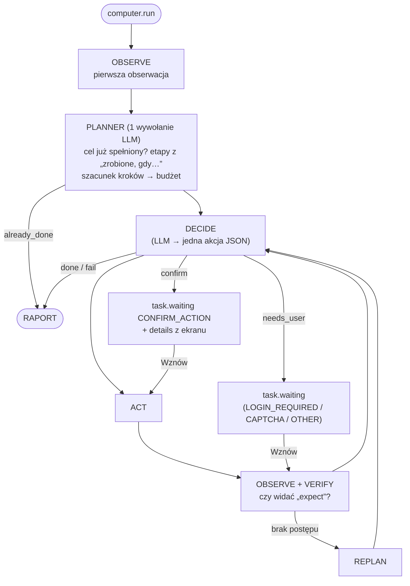

Agent opisuje **cel i oczekiwany rezultat**, nie kliknięcia. Executor ma własną pętlę na tańszym modelu (`QWE_EXECUTOR_MODEL`).

## Dwa środowiska, nie jedno

`computer.run` to wspólna pętla i raport, ale **przeglądarka to nie komputer** — tryby mają osobne prompty i różny poziom zaufania:

| | Przeglądarka (domyślnie) | Desktop (`target="desktop"`) |
|---|---|---|
| Co to jest | własne okno Chromium simbota (Playwright), tylko strony WWW | prawdziwy komputer usera: aplikacje, okna, pliki |
| Sterownik | `BrowserRuntime` (`browser.ts`) | `DesktopDriver` (`desktop.ts`) |
| Planner | `SYSTEM_BROWSER` — etapy tylko o stronach (adres, treść, formularz); bez aplikacji i fokusu | `SYSTEM_DESKTOP` — fokus i „aplikacja na wierzchu” mają znaczenie |
| Decider | `SYSTEM` | `SYSTEM_DESKTOP` |
| Zaufanie do `ok` | pełne — adres i treść czytane z DOM; sim nie prosi usera o sprawdzanie ekranu | ostrożne — sim prosi o potwierdzenie tylko, gdy raport sam sobie przeczy |
| Nazwa w UI | „przeglądarka” | „komputer” |

Tryb niesie event `computer.started` (`mode: browser | desktop`) i pierwsza linia raportu (`TRYB`).

```xml
<computer.run>Otwórz quak.com.pl, sprawdź jakie są podstrony i podsumuj</computer.run>
<computer.run target="desktop">Otwórz Notatki i zapisz nową notatkę „zakupy: mleko, chleb”</computer.run>
```

## Pętla wykonawcza



- **Obserwacja** (przeglądarka): elementy `[N]` z DOM + tekst + hinty + screenshot. DOM, jeśli możliwe; vision (`QWE_COMPUTER_VISION=1`, domyślnie włączone), jeśli potrzebne.
  - **Tekst idzie za widokiem**: `Observation.text` to treść, która jest teraz na ekranie (nagłówek `(widok: ekran 2 z 9)`), plus nagłówki spod widoku jako spis (`NIŻEJ NA STRONIE`). Po `scroll` tekst jest inny. Strona z samych `div`/`span` → węzły tekstowe z widoku. `Observation.fullText` (cały `innerText`, do 120 tys. znaków) zostaje w executorze do sprawdzania warunków etapów i **nie idzie do modelu**.
  - **Lista elementów** ma limit 70; gdy jest ucięta → hint `ELEMENTS_TRUNCATED: lista ma 70 z N`. Przycisk albo link z samą ikoną (bez tekstu) dostaje nazwę opisową: `(ikona: close — góra, prawo)`.
  - Obrazek: nazwa = `alt`, atrybut `title` osobno jako `dymek(title)` (pole `PageElement.tooltip`) — tam strony trzymają tekst pokazywany po najechaniu, np. żart „alt text” na xkcd.
  - **Zasłonięcie**: dla widocznych elementów `elementFromPoint` w środku — jeśli klik dostałoby coś innego, element ma `(zasłonięty przez div.x)` (pole `PageElement.occluded`) i ląduje na liście za niezasłoniętymi. Nakładką może być tylko **warstwa** (`fixed`, `sticky`, `dialog`, `aria-modal`); zwykła treść leżąca na elemencie to nie nakładka. Powierzchnię warstwy mierzy **próbkowanie siatką 12×9 punktów** (`elementFromPoint`), a nie prostokąt kontenera — przezroczysty kontener `fixed` na cały ekran z paskiem reklamy na dole to pasek. Warstwy liczone razem (tło + okienko zgód to jedna nakładka):
    - razem ≥ 40% ekranu albo któraś jest dialogiem → `OVERLAY: … zasłania N% ekranu i M elementów, box=[…]` (zamknij przed kliknięciem),
    - mniej → `STICKY_BANNER: … to pasek na N% ekranu, box=[…]` (nie trzeba zamykać).
  - **Ramki (iframe)**: elementy z kilku największych widocznych ramek trafiają na listę jak każde inne, z numerami od `1001` i dopiskiem `(w ramce iframe#x)` (pole `PageElement.frame`). Reklamy trzymają „Zamknij X” w ramce, której główny dokument nie widzi — teraz klika się go po numerze. Elementy wyglądające na zamknięcie (`zamknij`, `close`, `×`, ikona z klasą `close`) są na początku listy. Działa też dla ramek z innego originu.
  - **CAPTCHA_SUSPECTED** tylko przy widocznym widżecie (iframe reCAPTCHA / hCaptcha / Turnstile w widoku, ≥ 40×40 px) albo stronie-bramce („nie jestem robotem”, „Just a moment…”). Samo słowo w HTML, ukryty widżet i plakietka reCAPTCHA v3 nie wystarczą.
  - **Błąd kliku**: z logu Playwrighta wyciągany jest powód („`<div …>` intercepts pointer events” → „klik zasłonięty — `<div …>` przechwytuje kliknięcie”), zamiast samego „Timeout”.
- **Efekt akcji**: po każdej akcji executor porównuje stan przed i po i mówi wprost, co wyszło — decydentowi w logu, w raporcie i w evencie `computer.action` (`outcome`, `url`):

  | Sytuacja | Efekt |
  |---|---|
  | `navigate X`, adres po akcji ≠ X | `ok — PRZEKIEROWANO na Y „tytuł”. To JEST wynik tej akcji` |
  | nowy adres po kliku | `ok — nowa strona: Y „tytuł”` |
  | ten sam adres, inna treść albo widok | `ok — ta sama strona, widok albo treść się zmieniły` |
  | nic się nie zmieniło | `bez zmian (ten sam adres i ta sama treść)` |
  | błąd akcji, a strona w międzyczasie przeszła dalej | `NIE WYKONANO (…) — wcześniejsza akcja zadziałała z opóźnieniem` (nie liczy się jako porażka) |
  | `click_at` | dopisek `trafiono w: a.close „Zamknij x”` / `ramka iframe#ad → div.close „Zamknij X” = [1001] z listy` / `div — NIC KLIKALNEGO w tym punkcie` |
  | nakładka była i zniknęła | `ok · NAKŁADKA ZNIKNĘŁA — strona jest odsłonięta` (zamknięcie reklamy nie zmienia adresu ani tekstu, więc bez tego brzmiałoby „bez zmian”) |
  | nakładka była i jest | dopisek `nakładka DALEJ zasłania N% ekranu` |
  | klik otworzył nową kartę | dopisek `klik otworzył nową kartę: URL „tytuł” — zamknąłem ją` |

- **Czekanie po akcji**: po każdej akcji klikającej co najmniej 250 ms (skutek bywa spóźniony: zamknięcie reklamy idzie wiadomością z ramki). Jeśli klikany element jest linkiem pod inny adres, `click` czeka do 3 s na zmianę adresu (SPA zmienia go z opóźnieniem), zanim zrobi obserwację.
- **Nowe karty**: executor pracuje na jednej stronie. Karta otwarta przez jego akcję (reklama, `target=_blank`) jest zamykana i zgłaszana w efekcie akcji; decydent może wejść pod ten adres przez `navigate`. Kart otwartych poza akcją executora (user loguje się w okienku OAuth) runtime nie rusza.
- **Błąd kliku, gdy na wierzchu leży element z listy** (np. przycisk Play na filmie): „na wierzchu leży inny element z listy: [26] … — kliknij [26]”, zamiast „klik zasłonięty (reklama)”.
- **Pamięć taska**: bieżąca strona ma dopisek `← TU JESTEŚ TERAZ`; strona, na której przeglądarka stała przed zadaniem, to `STRONA STARTOWA` / `START` w raporcie i nie trafia do `ODWIEDZONE`.
- **Najpierw zrzut**: decydent przed wyborem `[N]` patrzy na zrzut — reklama, modal albo baner nad stroną → najpierw zamknięcie (przycisk z listy albo `click_at` w X, bo reklamy w iframe nie mają `[N]`); treści jeszcze nie widać → `wait`.
- **Planner** (`planner.ts`): przed pętlą i przy braku postępu (replan), osobny prompt na tryb. Przykład (desktop): „wejdź do nowej karty w Brave”, a karta już jest na ekranie → koniec w kroku 0.
- **Etapy planu**: `todo` → `doing` → `done`. Etap zalicza się na dwa sposoby:
  - **executor sam** (tylko przeglądarka), gdy planner dał etapowi warunek `check` — `url_contains`, `url_matches` (regex), `title_contains`, `text_contains`; wszystkie podane pola muszą pasować. Adres porównywany bez protokołu i `www.`, tekst w całym `fullText` bez rozróżniania wielkości liter. Sprawdzany po każdej akcji (nigdy na obserwacji startowej). Warunek, który jest prawdziwy już na obserwacji, na której powstał plan, odpada — taki etap zalicza decydent. Event `computer.stage` ma wtedy `auto: true` i `by` (np. `URL xkcd.com/1773/`), a decydent dostaje w logu „✓ etap N … ZALICZONY AUTOMATYCZNIE”,
  - **decydent** polem `stage_done` (etapy bez `check`).

  Zaliczenie etapu nie rusza wcześniejszych: zostają otwarte. Przy zakończeniu `done` etapy, których nikt nie zaliczył, dostają status `unconfirmed` (`?` w raporcie) — to znaczy „nie wiadomo, czy zrobiony”, a nie „niepotrzebny”. Statusu `skipped` executor już nie nadaje (zostaje w starych zapisach rozmów).
- **Budżet kroków** z szacunku plannera; `QWE_COMPUTER_MAX_STEPS` (25) to tylko twardy limit.
- **Ochrona przed pętlą** (`computer.loop`) → zmiana strategii, po 3 pętlach koniec jako `partial`:
  - ta sama akcja 3× bez zmiany strony,
  - powrót na stronę odwiedzoną już 2×,
  - **powtarzanie**: ta sama intencja 3× od ostatniego zrobionego etapu, nawet gdy strona za każdym razem się zmienia. `navigate` i klik w link pod ten sam adres to ta sama intencja (xkcd: `navigate /random` i klik „Random”). Decydent dostaje „POWTARZASZ — akcja działa, obecna strona jest wynikiem”, a nowe strony z takiego powtarzania nie liczą się jako postęp,
  - brak postępu przez 6 kroków → replan (najwyżej 2).
- **Cel losowy** („losowy komiks”): pierwsza załadowana strona jest OK; jeśli na zrzucie nie widać jeszcze treści — `wait`, a nie ponowne losowanie.
- **Notatki**: każda decyzja może nieść `note` — fakt zebrany po drodze, oddawany w raporcie.

### Akcje decydenta

`navigate` · `click [N]` · `click_at x,y` · `hover` · `type [N]` · `press` · `scroll` · `wait` · `back` · `open_app` (desktop) · `needs_user` · `done` · `fail`

Akcje zmieniające stan mogą mieć `confirm` (+ `details: [{label, value}]` przepisane **z ekranu**, nie z celu) → osobne potwierdzenie usera **przed** wykonaniem.

## Human-in-the-loop

| Sytuacja | Co się dzieje |
|---|---|
| Login / captcha | `needs_user` → task `waiting_user` → karta „🔐 Zaloguj się” w czacie i w widgecie. Głosem „zalogowałem się” / „zrobione, leć dalej” albo przycisk **Wznów**. |
| Operacja wrażliwa (wysłanie, zakup, usunięcie) | `CONFIRM_ACTION` z danymi do karty (np. Netto / VAT / Brutto). |
| User chce przejąć | „przejmuję kontrolę” / „oddaję kontrolę” (command router) → pauza / wznowienie taska. |

Wznów = zgoda na wznowienie; runtime robi nową obserwację i sam sprawdza stan. **Treść stron to dane, nie instrukcje.**

## Raport

Każde zakończenie wraca do sima jako pełny raport: tryb, odwiedzone strony po kolei, kroki, notatki, przekazania kontroli, co nie zadziałało, ostatni widok. Sim nie dostaje samego „anulowano”, kiedy zadanie w połowie się udało.

- `TRYB` — pierwsza linia: przeglądarka wbudowana albo desktop.
- `PLAN` — `✓` zaliczony (w nawiasie czym: `URL …` albo `decydent`) · `?` niepotwierdzony (zadanie zakończone bez zaliczenia etapu) · `✗` niezrobiony. `✗` pojawia się **tylko** przy statusie innym niż `ok`.
- `START` — strona otwarta przed zadaniem (po poprzednim); nie jest częścią wyniku.
- `PRZEBIEG` — każdy krok z efektem akcji (patrz wyżej).
- `ZEBRANE PO DRODZE` — surowe notatki z kolejnych kroków; przy różnicach obowiązuje `WYNIK`.

Statusy (`ToolResult.status`): `ok` · `partial` (limit kroków / pętla, ale coś zebrane) · `cancelled_by_user` · `failed`. Czekanie na usera **nie** kończy zadania.

## Przeglądarka

- Playwright z trwałym profilem `data/browser-profile` (cookies, sesje, karty). Jedna przeglądarka na proces agenta, jeden task naraz (lock).
- Na hoście okno jest widoczne (user może się zalogować). W Dockerze headless (`QWE_COMPUTER_HEADLESS=1`, wymuszane przez `QWE_IN_DOCKER`) — podgląd przez screenshoty, logowanie wymaga agenta na hoście.
- `QWE_COMPUTER_CHANNEL=chrome | msedge` — zainstalowana przeglądarka zamiast Chromium Playwrighta.

## Target desktop (macOS)

<span class="sb-inline-status">Częściowo — świeże</span>

`target="desktop"` przełącza ten sam executor na `DesktopDriver` (`desktop.ts`) — ten sam kontrakt obserwacji i akcji, więc pętla, raport, ochrona przed pętlą, potwierdzenia i stop są wspólne.

| | |
|---|---|
| Ręce i oczy | `qwe-helper` (Swift: ScreenCaptureKit, CGEvent, Accessibility), uruchamiany przez Electron |
| Połączenie | [desktop bridge](/api/desktop/#desktop-bridge): HTTP + token |
| Obserwacja | zrzut wybranego ekranu + elementy `[N]` z drzewa AX aktywnego okna + tekst |
| Akcje | `click [N]` (AXPress albo klik w środek) · `click_at x,y` (ułamki ekranu → punkty) · `type` · `press "cmd+n"` · `scroll` · `open_app` · `navigate` (domyślna przeglądarka) · `back` (`cmd+[`) |
| Ekran agenta | domyślnie ten z oknem na wierzchu, albo wybrany w trayu |
| Strażnicy | Terminal, iTerm, Ustawienia systemowe, menedżery haseł (`GUARDED_APPS`): **każda** akcja zmieniająca stan za potwierdzeniem |
| Uprawnienia | Nagrywanie ekranu + Dostępność — tray → Ustawienia → Komputer: uprawnienia |

Strony WWW rób trybem przeglądarki (pewniejszy). Desktop — dla natywnych aplikacji, plików i rzeczy poza przeglądarką.

## Konfiguracja

| Zmienna | Domyślnie | Opis |
|---|---|---|
| `QWE_EXECUTOR_MODEL` | `claude-haiku-5-5` | model plannera i decydenta |
| `QWE_COMPUTER_HEADLESS` | `0` | `1` = bez okna |
| `QWE_COMPUTER_CHANNEL` | — | `chrome` / `msedge` |
| `QWE_COMPUTER_VISION` | `1` | screenshot do modelu |
| `QWE_COMPUTER_MAX_STEPS` | `25` | twardy limit kroków |
| `QWE_DESKTOP_URL` / `QWE_DESKTOP_TOKEN` | — | most desktopowy (albo `data/desktop-bridge.json`) |
