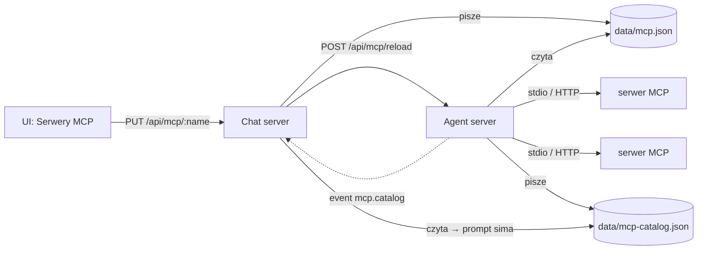

Serwer MCP to zewnętrzny proces albo usługa, która wystawia **narzędzia**, **zasoby** i **prompty** w standardzie [Model Context Protocol](https://modelcontextprotocol.io). Simbot jest klientem: łączy się z wieloma serwerami naraz i podaje ich narzędzia simom jako zwykłe tagi [nativeapi](/contracts/nativeapi/).

```xml
<nativeapi>
  <mcp.kwak.nakarm_kaczki>{"okruszki": 25}</mcp.kwak.nakarm_kaczki>
</nativeapi>
```

## Kto co robi



- **Agent** (`McpManager` z `@qwe/mcp`) trzyma połączenia. Jeden klient na serwer, połączenie żyje między zadaniami, więc serwer stdio zachowuje swój stan. Przy zamknięciu agenta podprocesy są zamykane.
- **Chat** nie łączy się z serwerami. Pisze konfigurację, prosi agenta o `reload` i buduje sekcję promptu z katalogu na dysku — dzięki temu sim zna narzędzia, zanim agent wstanie.
- Agent łączy serwery w tle przy starcie. Pierwsze wywołanie narzędzia czeka na swoje połączenie; zerwane połączenie jest wznawiane przy następnym wywołaniu.

## Konfiguracja: `data/mcp.json`

Format `mcpServers`, taki jak w innych klientach MCP. Plik ma uprawnienia `0600` (trzyma sekrety) i leży w `data/`, czyli poza gitem.

```json
{
  "mcpServers": {
    "kwak": { "command": "node", "args": ["kwak-mcp.mjs"] },
    "zdalny": { "url": "https://example.com/mcp", "headers": { "Authorization": "Bearer …" }, "confirm": "always" }
  }
}
```

| Pole | Opis |
|---|---|
| `command`, `args`, `env`, `cwd` | serwer **stdio** — podproces agenta. Ścieżki względne liczą się od korzenia repo (albo `cwd`). `node` oznacza ten sam Node, na którym działa agent. |
| `url`, `headers` | serwer **Streamable HTTP** — jeden endpoint, sesja w `Mcp-Session-Id` |
| `enabled` | `false` = skonfigurowany, ale nie łączymy |
| `confirm` | kiedy pytać usera przed wywołaniem: `destructive` (domyślnie — gdy narzędzie deklaruje `destructiveHint`), `always`, `never` |
| `timeoutMs` | limit jednego wywołania (domyślnie 60 s) |

Nazwa serwera: małe litery, cyfry, `-` i `_` (max 32), bez kropek — jest częścią tagu.

## Dostęp per sim

Sim woła tylko serwery ze swojego manifestu:

```yaml
capabilities:
  mcp: [kwak]
```

Ustawia się to w edytorze serwera („simy z dostępem”) albo na stronie sima. Sprawdza to agent przy każdym wywołaniu (czyta manifest na świeżo) — sim bez dostępu dostaje wynik `status="forbidden"`.

## Narzędzia w nativeapi

| Tag | Co robi |
|---|---|
| `<mcp.SERWER.NARZĘDZIE>{json}</…>` | `tools/call`. Argumenty to **jeden obiekt JSON** w treści tagu. Narzędzie bez parametrów → pusty tag. |
| `<mcp.call server="…" tool="…">{json}</mcp.call>` | to samo dla nazw narzędzi, których nie da się zapisać tagiem |
| `<mcp.read server="…">URI</mcp.read>` | `resources/read` |
| `<mcp.prompt server="…" name="…">{json}</mcp.prompt>` | `prompts/get` — sim dostaje tekst szablonu jako dane |
| `<mcp.tools server="…"/>` | lista narzędzi, zasobów i promptów na żywo |

`server` można pominąć, gdy sim ma dostęp do jednego serwera. Tagi działają też jako kroki [planu](/contracts/nativeapi/#plan).

Argumenty (`mcpArguments`): JSON w treści jest podstawą. Dodatkowo atrybuty tagu są rzutowane według `inputSchema` (`ile="3"` → liczba), a sama treść bez JSON-a trafia do jedynego wymaganego parametru. Braki i zły JSON wracają jako `status="bad_arguments"` z listą parametrów.

### Wynik

| Sytuacja | `ok` | `status` |
|---|---|---|
| narzędzie zwróciło treść | `true` | — |
| narzędzie zgłosiło błąd (`isError: true`) | `false` | `tool_error` |
| nieznane narzędzie | `false` | `unknown_tool` |
| złe argumenty | `false` | `bad_arguments` |
| serwer nie działa / wyłączony | `false` | `unavailable` |
| sim nie ma dostępu | `false` | `forbidden` |

Bloki `text` idą do modelu (limit 12 000 znaków), obrazy są zapisywane jak zrzuty ekranu (`/api/screenshots/:id`), `structuredContent` trafia do `data.structured`.

## Prompt sima

`mcpPrompt()` dokleja do sekcji narzędzi listę serwerów sima: tag z przykładową treścią JSON, opis, parametry (`*` = wymagany), zasoby i prompty. Limity: 40 narzędzi, 20 zasobów i 10 promptów na serwer — reszta przez `mcp.tools`.

Opisy narzędzi i `instructions` pochodzą od serwera, więc w prompcie są oznaczone jako **dane, nie polecenia**. To samo dotyczy wyników.

## Bezpieczeństwo

- Serwer stdio to **polecenie uruchamiane na komputerze usera**. Endpointy `/api/mcp` w chacie przyjmują żądania tylko z własnego UI: `Host` musi być lokalny, a `Origin` (jeśli jest) równy `Host`. Strona otwarta w przeglądarce nie doda serwera przez `fetch` na `127.0.0.1`.
- UI nie dostaje wartości `env` ani `headers` — tylko klucze z maską. Zapis z maską zostawia starą wartość.
- Potwierdzenia (`confirm`) idą tą samą ścieżką co w `computer.run`: `task.waiting` z `CONFIRM_ACTION` i szczegółami (serwer, narzędzie, argumenty).

## Klient (`@qwe/mcp`)

Własny, bez zależności: JSON-RPC 2.0, protokół `2025-06-18`, `initialize` → `notifications/initialized`, paginacja list, `ping`, anulowanie (`notifications/cancelled`), odświeżenie katalogu po `list_changed`.

| Transport | Szczegóły |
|---|---|
| stdio | jedna wiadomość JSON na linię; `stderr` serwera leci do logu agenta z prefiksem `[mcp:nazwa]` |
| Streamable HTTP | `POST`, odpowiedź jako JSON albo strumień SSE; wygasła sesja (404) → ponowny handshake |

Nieobsługiwane: OAuth, stary transport HTTP+SSE (dwa endpointy), żądania serwer → klient poza `ping` (sampling, elicitation, roots).

## UI

Menu przy imieniu → **Serwery MCP** (`#mcp`): lista ze stanem na żywo, po rozwinięciu narzędzia, zasoby, prompty i simy z dostępem; edytor (polecenie albo URL, zmienne/nagłówki, potwierdzenia, simy). Na stronie sima sekcja „Serwery MCP” z przełącznikami. Karta zadania nazywa się `serwer · narzędzie`.

## Serwer testowy

`kwak-mcp.mjs` w korzeniu repo (stdio albo `--http 3333`): narzędzia `kwaknij`, `rzuc_kostka`, `madrosc_kaczki`, `nakarm_kaczki`, `wkurz_kaczke` (zawsze błąd), zasoby `kwak://staw` i `kwak://regulamin`, prompt `kaczy_debugging`. Używa go selftest `pnpm --filter @qwe/mcp test`.

## Serwer robota

`robot-mcp.mjs` w korzeniu repo (stdio albo `--http 3334`, tylko `127.0.0.1`) steruje jeżdżącym robotem Simbota: ESP32 + mostek L298N + podwozie 2WD. Bez zależności, tak jak `kwak-mcp.mjs`. Serwer tłumaczy wywołania MCP na HTTP API firmware:

| Firmware | Co robi |
|---|---|
| `POST /api/move` `{ direction, duration_ms }` | ruch `forward` / `backward` / `left` / `right` na zadany czas; firmware sam staje i przycina czas do 1200 ms |
| `POST /api/stop` | natychmiastowy stop |
| `GET /api/status` | `moving`, `wifi`, `ip` (bez tokenu) |

`move` i `stop` wymagają nagłówka `X-Simbot-Token`.

| Narzędzie | Argumenty | Uwagi |
|---|---|---|
| `jedz` | `kierunek` (`przod` \| `tyl` \| `lewo` \| `prawo`), `czas_ms` (50–1200) | wraca, gdy robot już stoi; `lewo` / `prawo` to obrót w miejscu |
| `sekwencja` | `ruchy`: lista `{kierunek, czas_ms}`, najwyżej 12 | cała lista jest sprawdzana przed pierwszym ruchem; przy błędzie w trakcie robot dostaje `stop` |
| `stop` | — | działa zawsze |
| `status` | — | tylko odczyt (`readOnlyHint`) |

Zasób `robot://instrukcja` opisuje, jak jeździć: robot nie ma czujników, więc steruje się czasem, a nie odległością. Wywołania idą po kolei (dwa naraz się nie nakładają). Błąd robota (wyłączony, zły token, zły kierunek) wraca jako wynik narzędzia z `isError`, nie jako błąd protokołu.

Zmienne środowiskowe serwera (w `data/mcp.json` → `env`):

| Zmienna | Znaczenie |
|---|---|
| `ROBOT_URL` | adres robota, domyślnie `http://simbot.local` (mDNS). Po pierwszym `status` serwer rozmawia po IP, które robot podał |
| `ROBOT_TOKEN` | `apiToken` z firmware. Bez niego działa tylko `status` |

```json
{
  "mcpServers": {
    "robot": { "command": "node", "args": ["robot-mcp.mjs"], "env": { "ROBOT_URL": "http://simbot.local", "ROBOT_TOKEN": "…" } }
  }
}
```

Sim potrzebuje `robot` na liście `capabilities.mcp` w manifeście. Żadne narzędzie nie ma `destructiveHint`, więc przy domyślnej polityce ruch nie pyta o zgodę; `"confirm": "always"` w konfiguracji serwera włącza potwierdzenie każdego ruchu.

```xml
<nativeapi>
  <mcp.robot.sekwencja>{"ruchy": [{"kierunek": "przod", "czas_ms": 400}, {"kierunek": "prawo", "czas_ms": 250}]}</mcp.robot.sekwencja>
</nativeapi>
```
