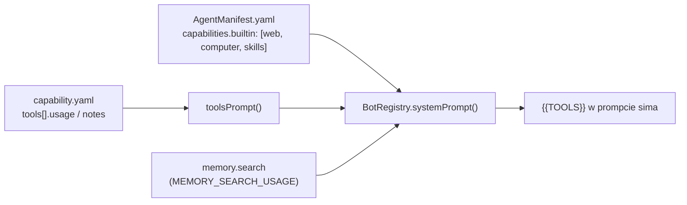

| Tool | Capability | Gdzie się wykonuje | Stan |
|---|---|---|---|
| [`web.query`](/capabilities/web/) | `web` (`plugins/web`) | agent | Działa |
| [`computer.run`](/capabilities/computer/) | `computer` (`plugins/computer`) | agent (+ helper dla `target="desktop"`) | Przeglądarka: działa · desktop: częściowo |
| [`skill.save`](/capabilities/skills/) | `skills` (`plugins/skills`) | agent | Działa |
| [`memory.search`](/capabilities/memory/) | — (narzędzie lokalne) | chat server | Działa |
| [`mcp.<serwer>.<narzędzie>`](/capabilities/mcp/) | — (serwery MCP, `@qwe/mcp`) | agent | Działa — świeże |

## Skąd sim wie, co umie

- Sim widzi tylko capability ze **swojego** manifestu, ale agent server ładuje unię capability wszystkich simów.
- `memory.search` jest dopisywane każdemu simowi i wykonywane w chacie (potrzebuje bazy rozmów).

## Własne narzędzia

Lokalny plugin w `agents/<name>/plugins/` albo paczka npm w `capabilities.packages`. Przewodnik: [Napisz własną capability](/capabilities/writing-plugins/).
