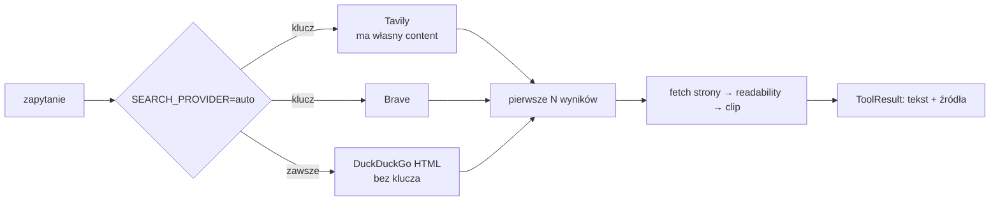

```xml
<nativeapi>
  <web.query>bilet miesięczny ZTM Poznań cena 2026</web.query>
</nativeapi>
```

Jedno zapytanie w tagu, konkretne jak do Google. Wynik: lista źródeł z treścią stron gotową dla LLM.

## Jak działa



1. Provider: `auto` = tavily → brave → duckduckgo (pierwszy dostępny / działający).
2. Dla pierwszych `SEARCH_FETCH_PAGES` wyników: pobranie strony, `@mozilla/readability` + `linkedom`, przycięcie do `SEARCH_PAGE_CHARS`.
3. Eventy: `web.started` → `web.progress` → `web.completed`.

Nowy provider = jedna funkcja `(query, n) → SearchResult[]` i wpis w `PROVIDERS` (`search.ts`).

## Konfiguracja

| Zmienna | Domyślnie | Opis |
|---|---|---|
| `SEARCH_PROVIDER` | `auto` | `auto` · `tavily` · `brave` · `duckduckgo` |
| `TAVILY_API_KEY` / `BRAVE_API_KEY` | — | opcjonalne |
| `SEARCH_MAX_RESULTS` | `5` | wyników z wyszukiwarki |
| `SEARCH_FETCH_PAGES` | `3` | ile stron pobrać i przeczytać |
| `SEARCH_PAGE_CHARS` | `3500` | limit treści na stronę |

W kontekście starszych tur wynik jest skracany do listy źródeł (`[n] tytuł + adres`) — zob. [Kontekst modelu](/architecture/data/#kontekst-modelu).
