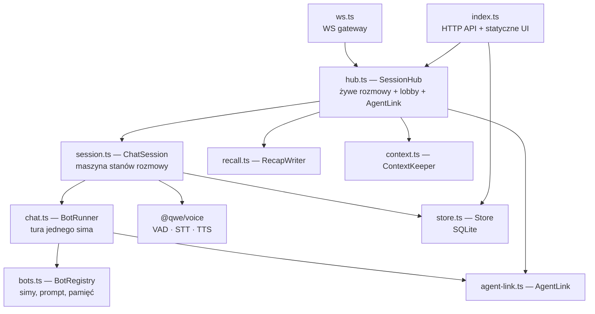

Serce aplikacji. Trzyma rozmowy i simy, rozmawia z modelem, prowadzi głos, zleca zadania agentowi i serwuje UI. Port `3100`.

## Struktura

## Pliki

| Plik | Odpowiada za |
|---|---|
| `index.ts` | Boot, konfiguracja, wszystkie [endpointy REST](/api/chat-rest/), statyczne `public/`, `/healthz`. |
| `hub.ts` | `SessionHub`: rejestr żywych `ChatSession` po id, lobby (`session.updated/removed`, `notify`, `agent.status`), jeden `AgentLink` na proces. |
| `session.ts` | `ChatSession`: stan rozmowy, dispatch `@`, kolejka simów i łańcuch (max 3), głos half-duplex, command router w trakcie pracy komputera, `control(op)`, zapis eventów. |
| `chat.ts` | `BotRunner`: historia z perspektywy sima → LLM stream → `say.*` / `<nativeapi>` → task → `<nativeresult>` → LLM. |
| `bots.ts` | `BotRegistry`: simy z `agents/`, prompt systemowy (kontrakt + persona + skille + narzędzia + pamięć + kontekst rozmowy), CRUD, profil usera, auto-tworzenie Simy. |
| `context.ts` | Co z rozmowy idzie do modelu: skracanie starych wyników, kroczące streszczenie. |
| `recall.ts` | Recap rozmów po ciszy, przegląd zaległych, lokalne narzędzie `memory.search`. |
| `models.ts` | Wybór modeli: `GET/PUT /api/llm`, start Ollamy, pobieranie modeli; zapis w `settings["llm"]`, przekazanie agentowi (`AgentLink.setLlm`). |
| `files.ts` | Folder plików rozmowy (`<data>/sessions/<id>/files`, z podfolderami): zapis, lista (`listDir`, `listAll`), nowy folder, przeniesienie, usunięcie, wymiary obrazów, `@[ścieżka]` (`resolveScope`), pliki w kontekście (budżet), narzędzia `files.list` / `files.read` / `files.look`. Zob. [Pliki rozmowy](/capabilities/files/). |
| `agent-link.ts` | `ensure()` (spawn albo `/health`), `submit()` (POST + czekanie na terminalny event), jedno SSE na cały chat. |
| `store.ts` | SQLite: schemat, migracje, zapytania. Zob. [Dane](/architecture/data/). |
| `ws.ts` | [WebSocket](/api/chat-ws/): mirror busa rozmowy, binarne audio, lobby. |
| `events.ts` | `ChatEvents` — typowana mapa eventów in-process. |
| `prompts/system.md` | [Kontrakt sima](/contracts/nativeapi/#prompt-systemowy) z placeholderami `{{BOT}}`, `{{USER}}`, `{{TOOLS}}`. |

## Prompt systemowy sima

Składany w `BotRegistry.systemPrompt()`:

1. `prompts/system.md` — kontrakt: jak mówić (głos vs tekst), `@`, narzędzia i `<nativeapi>`.
2. `{{TOOLS}}` — `toolsPrompt()` z deskryptorów capability, które sim ma w manifeście, plus `memory.search` i `files.*`.
3. Skille sima (`skills/*.md`).
4. `persona.md`.
5. Migawka pamięci (fakty o userze + notatki sima) i lista ostatnich rozmów.

Poza cache'owanym blokiem dochodzi `conversationPrompt()`: kto jest w rozmowie, workflow rozmowy i tryb bieżącej wiadomości (głos / tekst, `@sim.task`).

## Rozmowa żyje bez okna

`ChatSession` nie zależy od podłączonych klientów. Zamknięcie karty przeglądarki tylko resetuje VAD; zadanie w tle dojeżdża, wiadomości i eventy trafiają do bazy, `unread` rośnie, a sim wołający `@user` w rozmowie, na którą nikt nie patrzy, wysyła `notify` do lobby.
