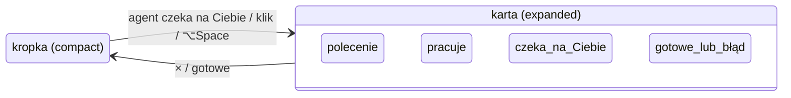

`apps/desktop` to **tylko skorupa**. Startuje chat (albo podpina się pod działający `qwe dev`) i otwiera dwa okna na ten sam adres. Runtime (chat + agent) pracuje niezależnie od okien. Nazwa aplikacji: `simbot`, Electron `45.2.3`.

```bash
qwe desktop          # okno główne + widget + ikona w pasku menu
qwe desktop --mock   # bez kluczy
```

## Okna

| Okno | Adres | Cechy |
|---|---|---|
| **Główne** — centrum dowodzenia | `/` | simy, rozmowy, kroki, zrzuty, panel komputera |
| **Widget** — kokpit na pulpicie | `/widget.html?session=…` | `type: 'panel'` (NSPanel, nie kradnie fokusu), `alwaysOnTop`, `frame: false`, `setContentProtection(true)` — **niewidoczny na zrzutach agenta**, więc agent nie kliknie we własny stop |

**Agent działa na hoście.** Desktop nie zmienia `QWE_AGENT_MODE`, więc domyślnie (`spawn`) chat podnosi agenta jako proces na tej samej maszynie. Tak jest prościej i tak musi być: Playwright potrzebuje widocznego okna do logowania usera, a helper Swift działa tylko na hoście. Agent w Dockerze (`QWE_AGENT_MODE=url`, `qwe run`) zostaje opcją dla przeglądarki, desktop jej nie używa. `qwe dev` w przeglądarce działa obok desktopu — Electron tylko się podpina.

Bezpieczeństwo okien: `contextIsolation`, bez `nodeIntegration`, ładowanie tylko z `127.0.0.1:<port>`, linki zewnętrzne przez `shell.openExternal`. Jedyny most UI ↔ Electron to `window.qwe` z preloadu — w zwykłej przeglądarce go nie ma i UI działa jak wcześniej. Zob. [Desktop API](/api/desktop/).

## Widget



- **Kolor plakietki** = stan: niebieski pracuje · żółty czeka na Ciebie · czerwony błąd / ktoś woła · szary wstrzymane.
- **Start zadania nie rozwija widgetu.** Rozwija się sam dopiero, gdy agent czeka na Ciebie — według ustawienia: rozwiń / tylko kropka / tylko ikona w trayu.
- Gotowe = krótka informacja; błąd zostaje na plakietce, aż go obejrzysz.
- Wstrzymaj / Wznów / Anuluj osobno. Widzi też inne rozmowy, w których simy pracują.
- **Przeciąganie** za kropkę albo nagłówek; przykleja się do krawędzi, nie wyjeżdża poza ekran; pozycja i monitor zapamiętane, odłączony monitor → wraca na dostępny.
- **Schowany widget ≠ zatrzymany agent.**
- ↗ / „Popraw” otwiera okno główne dokładnie na tej rozmowie i tym zadaniu.

## Tray i menu

Pokaż/schowaj widget · Polecenie… · Otwórz simbot · Nowa rozmowa · Wstrzymaj wszystko · Zatrzymaj wszystko · Ustawienia · Zakończ. Prawy klik na kropce = to samo menu. Ikona traya ma stany: idle, mruga, pracuje, czeka (`assets/tray-*Template.png`).

**Ustawienia** (`~/Library/Application Support/simbot/desktop.json`):

| Ustawienie | Wartości |
|---|---|
| Gdy agent czeka na Ciebie | pokaż i rozwiń widget (domyślnie) · pokaż kropkę · tylko ikona |
| Uruchamiaj przy logowaniu | tak / nie |
| Startuj bez okna (tylko widget) | tak / nie |
| Komputer: ekran agenta | aktywny (z oknem na wierzchu) albo konkretny monitor |
| Komputer: uprawnienia | stan i nadawanie: Nagrywanie ekranu, Dostępność |

## Skróty

| Skrót | Działanie | Zmienna |
|---|---|---|
| `⌥Space` | polecenie w widgecie z dowolnego miejsca | `QWE_SHORTCUT_WIDGET` |
| `⌃⌥Esc` | zatrzymaj wszystko (cancel aktywnych tasków) | `QWE_SHORTCUT_STOP` |
| `⌘⇧W` | pokaż / schowaj widget | — |
| `⌘N` / `⌘K` | nowa rozmowa / szukaj rozmowy | — |

## Helper Swift i tryb desktop

`helper/qwe-helper.swift` — natywne ręce i oczy agenta na macOS (ScreenCaptureKit, CGEvent, Accessibility). Uruchamia go Electron, więc zgody macOS należą do *simbot*. Agent woła go przez **desktop bridge** (HTTP + token). Opis akcji: [computer → target desktop](/capabilities/computer/#target-desktop-macos). Protokół: [Desktop API](/api/desktop/).

```bash
pnpm --filter @qwe/desktop helper   # swiftc → helper/build/qwe-helper (wystarczą Command Line Tools, Xcode niepotrzebny)
pnpm --filter @qwe/desktop icons    # ikony aplikacji i traya
```

:::caution[Niepodpisany build]
Dev build nie jest podpisany — uprawnienia TCC dostaje `Electron.app` z `node_modules` i po każdej aktualizacji Electrona trzeba je nadać ponownie. Do dystrybucji potrzebne są Developer ID i notaryzacja (zob. [Roadmapa](/status/roadmap/)).
:::
