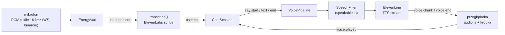

| Plik | Co robi |
|---|---|
| `vad.ts` | Energetyczny VAD — zamyka wypowiedź po ciszy (`user.utterance`, `user.heard`, poziom `user.level`). |
| `stt.ts` | Transkrypcja wypowiedzi (`ELEVEN_STT_MODEL`, domyślnie `scribe_v1`). |
| `pipeline.ts` | Słucha `say.*`, zamienia je na `voice.chunk` / `voice.end`. Synteza zaczyna się, zanim sim skończy pisać; gdy sim poszedł do narzędzia, głos i narzędzie lecą równolegle. |
| `speakable.ts` | Filtr: co z tekstu da się przeczytać (bez markdownu, linków, bloków). |
| `tts.ts` | `ElevenLine` (stream TTS, `ELEVEN_TTS_MODEL`) i `MockLine` (ton zamiast głosu w `--mock`). |
| `config.ts` | `voiceConfigFromEnv()`. |

**Głos sima:** `look.voice` w manifeście = ElevenLabs voiceId. Puste → `ELEVEN_VOICE_ID`.

**Half-duplex:** kiedy sim mówi, VAD jest wyciszony. `Esc` → `user.interrupt` → `voice.abort`.

**Bez klucza ElevenLabs** chat działa tekstowo; głos jest dostępny tylko w `--mock` (ton).

Ramka binarna `voice.chunk` na WS: [Chat WebSocket](/api/chat-ws/#ramki-binarne).
