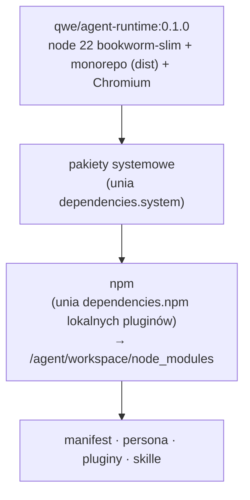

```bash
qwe build --runtime                  # raz: qwe/agent-runtime:0.1.0 (monorepo + Chromium)
qwe build agents/sima                # AgentManifest.yaml + capability.yaml → Dockerfile → docker build
qwe build agents/sima --dry-run      # tylko wygeneruj i pokaż plan (depsy, hash)
qwe run agents/sima                  # kontener qwe-sima (port 7777) + chat na hoście
qwe ps
qwe logs sima
qwe stop sima
```

## Warstwy obrazu sima



- Dockerfile generowany do `agents/<sim>/.qwe/build/Dockerfile`.
- Zależności npm idą do `/agent/workspace/node_modules`, bo ESM nie zna `NODE_PATH`.
- **Konflikty zakresów** między pluginami → `qwe build` kończy się głośnym błędem.
- `buildHash` jest content-addressed (manifest + pluginy + depsy) i trafia do `QWE_BUILD_HASH`.

## Instancje

`qwe run` tworzy kontener `qwe-<name>`:

- port `-p <port>:7777` (`--port`),
- wolumen `~/.qwe/instances/<name>` → `/agent/data` — dane przeżywają rebuildy,
- `QWE_INSTANCE_ID=<name>`, `--env-file .env`, etykieta `org.qwe.instance=1`,
- potem chat na hoście z `QWE_AGENT_MODE=url` (pomiń przez `--no-chat`).

:::caution[Computer w kontenerze]
W Dockerze przeglądarka jest headless. Logowanie przez usera wymaga agenta na hoście (`qwe dev`). Tryb `target="desktop"` potrzebuje mostu Electrona na hoście.
:::

:::note[Do sprawdzenia]
`docker/runtime.Dockerfile` kopiuje `package.json` z `plugins/web` i `plugins/computer`, ale nie z `plugins/skills`, który powstał później. Warstwa `pnpm install --frozen-lockfile` może więc nie zlinkować `@qwe/plugin-skills`. Warto to sprawdzić przy następnym `qwe build --runtime`.
:::
