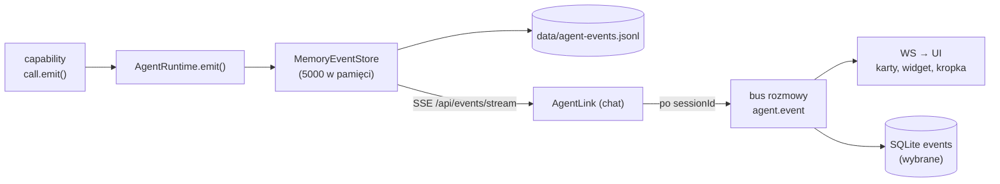

Eventy to kręgosłup Simbota. Każdy moduł tylko emituje i słucha: nowe narzędzie albo nowa animacja = nowy event + subskrybent, bez grzebania w reszcie.

## Koperta

```ts
interface AgentEvent<T = Record<string, unknown>> {
  seq: number;        // monotoniczny w obrębie procesu agenta
  type: string;       // "task.started", "computer.action", …
  at: string;         // ISO
  sessionId?: string; // rozmowa — żeby nie mieszać rozmów
  taskId?: string;
  planId?: string;
  stepId?: string;
  data: T;
}
```

## Droga eventu



Zasada obserwatora: **nie streamujemy każdego odczytu DOM**. Event, gdy zmieniła się sytuacja, agent podjął akcję, trzeba usera albo koniec. Screenshoty idą po `screenshotId`, nigdy w evencie.

## Katalog: agent server

| Warstwa | Eventy | Ważne pola `data` |
|---|---|---|
| task | `task.enqueued` · `started` · `waiting` · `resumed` · `paused` · `succeeded` · `failed` · `cancelled` | `enqueued`: `kind`, `agent`, `calls`; `waiting`: `reason`, `message`, meta (np. `details`); `resumed`: `after`; `succeeded`: `ok`, `parts` |
| plan | `plan.started` · `plan.completed` · `plan.failed` | `steps[]` (`id`, `name`, `after` / `status`, `ms`, `error`) |
| step | `step.started` · `step.completed` · `step.failed` · `step.skipped` | `stepId`, `name`, `ms`, `data`, `error`, `reason` |
| tool | `tool.call` · `tool.result` | `name`, `args` / `ok`, `status`, `ms`, `data`, `error` |
| web | `web.started` · `web.progress` · `web.completed` | zapytanie, provider, źródła |
| computer | `computer.started` · `plan` · `stage` · `verify` · `observation` · `action` · `note` · `loop` · `resumed` · `completed` · `failed` · `cancelled` | `started`: `goal`, `maxSteps`, `mode` (`browser` \| `desktop`); `observation`: `url`, `title`, `screenshotId`, `hints`, `elements`; `action`: `step`, `action`, `label`, `status` (`started`, potem jeden event `completed` \| `failed` po nowej obserwacji), `error`, `outcome` (co akcja dała: „PRZEKIEROWANO na …”, „bez zmian”, „trafiono w: …”), `url` (adres po akcji); `plan`: `stages[]` (`id`, `title`, `doneWhen`, `kind`, `check`, `req`, `by`, `status`), `budget`; `stage`: `id`, `title`, `kind` (`state` \| `action` \| `info`), `status` (`done` \| `unconfirmed` \| `unmet`; `skipped` tylko w starych zapisach), `by` (dowód), `auto` (zaliczony przez executor z warunku planu), `why` (czemu nie zaliczono), `blocked`, `next`; `verify`: `ok`, `repair` (czy executor daje podejście naprawcze), `steps`, `unmet[]` (`id`, `title`, `kind`, `why`); `completed`: `result`, `steps`, `status` (`ok` \| `partial` — wynik jest, ale nie wszystkie wymagania), `unmet[]` |
| skills | `skill.saved` | `agent`, `name`, `description`, `path`, `chars` → chat przeładowuje prompt sima |
| mcp | `mcp.catalog` | `name`, `transport`, `state`, `error`, `tools`, `resources`, `prompts` — bez `taskId`; chat czyści cache promptów i wysyła `mcp.status` do lobby |

## Katalog: chat (in-process)

Typowana mapa `ChatEvents` w `apps/chat/src/events.ts`. Eventy agenta są re-emitowane na busie rozmowy jako `agent.event` (payload = cała koperta).

| Tor | Eventy |
|---|---|
| user | `user.utterance` · `user.heard` · `user.text` · `user.level` · `user.interrupt` · `user.command` |
| sim | `agent.state` · `bot.turn` · `agent.thinking` · `agent.error` · `assistant.message` · `mention.user` · `mention.absent` |
| narzędzia | `tool.call` · `tool.result` (po stronie chatu: `callId`, `taskId`, `bot`, `found`) |
| mowa | `say.start` · `say.text` · `say.end` · `voice.chunk` · `voice.end` · `voice.played` · `voice.abort` |
| rozmowa | `session.voice` · `session.title` · `session.reset` · `session.members` · `session.workflow` · `memory.saved` |

`agent.state` ∈ `idle · listening · thinking · speaking · working · waiting_user` — napędza kropkę, widget i sidebar.

## Co jest zapisywane

| Gdzie | Co |
|---|---|
| `data/agent-events.jsonl` | wszystkie eventy agenta (append-only) |
| SQLite `events` | z agenta: `task.*`, `plan.*`, `step.*`, `tool.*`, `web.started/completed`, `computer.{started, needs_user, completed, failed, cancelled, action, observation, note, loop}`; bez szumu z chatu (`say.*`, `voice.*`, `user.level`, `agent.state`…) |

Po reloadzie UI odtwarza karty z `GET /api/sessions/:id` → `events`.

## Dodanie eventu

1. Emituj z capability: `call.emit("moja.rzecz", { … })` — koperta dostaje `taskId/sessionId/stepId` sama.
2. Jeśli UI ma go odtwarzać po reloadzie — dopisz prefiks do `PERSIST_AGENT` w `apps/chat/src/session.ts`.
3. Obsłuż w `apps/chat/public/ui/cards.js` (karta) albo `widget.js`.
4. Dopisz go do tabeli wyżej.
