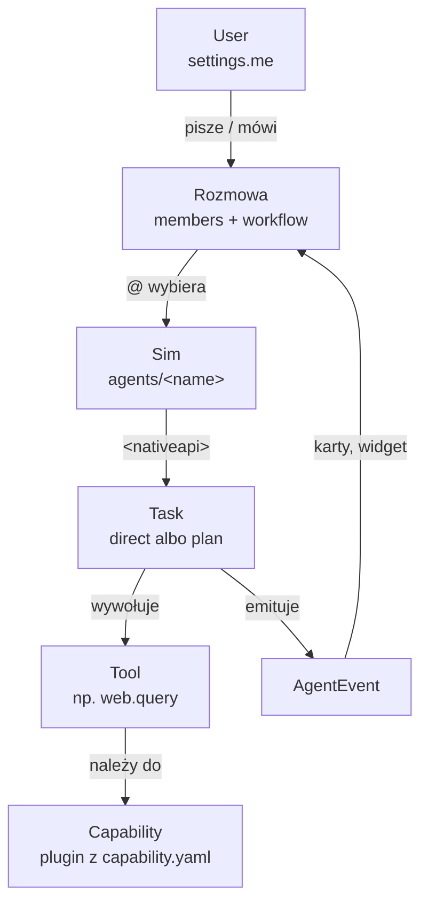

Krótki słownik. Każde pojęcie prowadzi do strony, która opisuje je dokładnie.

## Ludzie i simy

**User** — Ty. Imię, slug do `@` (np. „Kacper Walczak” → `@kacper`) i awatar, zapisane w `settings.me` w SQLite. Wchodzi do promptu każdego sima jako `{{USER}}` / `{{USER_SLUG}}`. → [Mentions](/contracts/mentions/)

**Sim** — agent z własną tożsamością. Na dysku to folder `agents/<name>/` z [`AgentManifest.yaml`](/contracts/agent-manifest/), `persona.md`, `memory.md`, `skills/` i opcjonalnie `plugins/`. W UI ma kolor, awatar i głos (`look`). Tworzysz go w UI albo przez `POST /api/bots`.

**Sima** — domyślny sim aplikacji (`agents/sima`). Tworzy się sam przy starcie, jeśli go nie ma, i nie da się go usunąć. Rozmowa bez wybranych simów idzie do Simy.

**Persona** — `persona.md`: kim sim jest i jak mówi. Dopinana do [kontraktu systemowego](/contracts/nativeapi/#prompt-systemowy) (`apps/chat/prompts/system.md`).

## Rozmowy

**Rozmowa** (session) — wątek z listą członków (`members[]`, pierwszy = prowadzący) i opcjonalnym workflow. Historia jest jedna, ale każdy sim widzi ją **ze swojej perspektywy**. Żyje w procesie chatu niezależnie od okna: zadanie w tle dojeżdża, karty odtwarzają się po reloadzie. → [Cykl życia tury](/architecture/lifecycle/)

**Workflow** — tekstowa instrukcja, jak simy mają się zachowywać w danej rozmowie („księgowy wystawia, audytor sprawdza”). Tabela `workflows` w SQLite, wchodzi do promptu każdego członka.

**Mention** — `@sim` (zapytaj), `@sim.task` (zleć zadanie), `@user` (powiadomienie). `@nazwa:` z dwukropkiem to cytat, nie wołanie. → [Mentions](/contracts/mentions/)

**Lobby** — specjalny kanał WS (`?session=lobby`): lista rozmów na żywo, powiadomienia, stan agenta.

## Wykonanie

**`<nativeapi>`** — jedyny sposób, w jaki model wywołuje świat. Blok XML na końcu odpowiedzi. → [Kontrakt nativeapi](/contracts/nativeapi/)

**Direct call** — jeden (albo kilka niezależnych) tagów narzędzi w bloku.

**Plan** — `<plan>` z krokami; `id` nazywa krok, `after` mówi, na co czeka. Kroki bez `after` idą równolegle. Plan nie jest narzędziem — to kontener wykonawczy.

**Task** — jednostka pracy w agent serverze, powstaje z bloku `<nativeapi>`. Stany: `queued → running → waiting_user / paused → succeeded | failed | cancelled`. → [Agent server](/components/agent/)

**Capability** — plugin dostarczający narzędzia: `capability.yaml` (deskryptor) + `index.(ts|js)` z `create(ctx)`. Wbudowane: `web`, `computer`, `skills`. → [Kontrakt capability](/contracts/capability/)

**Tool** — pojedyncze narzędzie capability, np. `web.query`, `computer.run`, `skill.save`. Nazwa toola = nazwa tagu w `<nativeapi>`.

**Local tool** — narzędzie wykonywane w chat serverze zamiast w agencie (bo potrzebuje bazy rozmów): dziś tylko `memory.search`.

**Skill** — plik markdown z frontmatterem w `agents/<name>/skills/`. Trafia do promptu sima jako „jak podchodzić do zadań”. Sim może sam zapisać skill przez `skill.save`.

**Human-in-the-loop** — capability może zatrzymać task (`waitForUser`) z powodem `LOGIN_REQUIRED`, `CONFIRM_ACTION`, `CAPTCHA`, `USER_CONTROL` albo `OTHER`. Przycisk „Wznów” to zgoda na wznowienie, a nie potwierdzenie stanu.

## Komunikacja

**AgentEvent** — uniwersalna koperta `{ seq, type, at, sessionId?, taskId?, planId?, stepId?, data }`. → [Eventy](/events/)

**AgentLink** — po stronie chatu: podnosi agenta (`spawn`) albo sprawdza `/health` (`url`), wysyła taski, trzyma jedno połączenie SSE. → [Chat server](/components/chat/)

**Desktop bridge** — HTTP z tokenem w Electronie, przez który agent steruje `qwe-helper` (Swift). → [Desktop API](/api/desktop/)

**Widget** — zawsze widoczny „kokpit” Electrona: kropka ↔ karta, stan pracy simów, Wstrzymaj / Wznów / Anuluj. → [Desktop](/components/desktop/)

**Kropka** — holograficzny torus (three.js), twarz głosu, sterowany stanem rozmowy.
