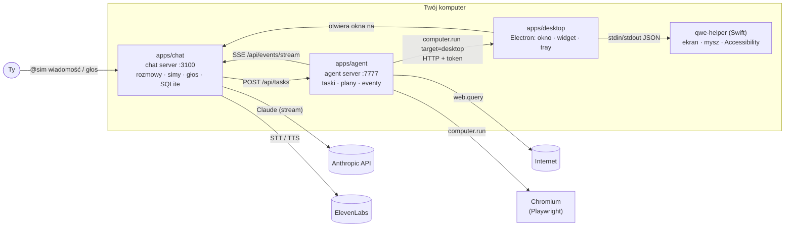

**Simbot** to aplikacja, w której rozmawiasz z **simami** — agentami z własną rolą, personą, narzędziami, skillami i pamięcią. Jednym albo kilkoma naraz. Sim, kiedy trzeba, szuka w sieci albo **bierze komputer** (przeglądarkę albo cały pulpit macOS), klika, czyta i wraca z raportem. Działa w przeglądarce (`qwe dev`) i jako aplikacja desktopowa na Electronie (`qwe desktop`) z widgetem nad wszystkimi oknami.

:::note[Nazewnictwo]
W kodzie projekt nazywa się **qwe** (paczki `@qwe/*`, CLI `qwe`, zmienne `QWE_*`). Produkt i aplikacja desktopowa to **simbot** (`app.setName('simbot')`). W tej dokumentacji: *Simbot* = produkt, `qwe` = kod i narzędzia.
:::

## Całość na jednym obrazku

## Trzy zasady, które tłumaczą resztę

1. **Model mówi, a świat woła jednym tagiem.** Sim pisze zwykły tekst (który od razu idzie do UI i syntezy mowy), a kiedy potrzebuje narzędzia — kończy odpowiedź blokiem [`<nativeapi>`](/contracts/nativeapi/). Nie ma tool-use API Anthropic; jest własny, prosty kontrakt XML z planami i zależnościami.
2. **Chat i agent to osobne procesy.** Chat trzyma rozmowy, simy i głos. Agent wykonuje zadania i nadaje eventy. Agent **wstaje leniwie** — dopiero przy pierwszej akcji — i może chodzić na hoście albo w Dockerze. Zobacz [Procesy i komunikacja](/architecture/system/).
3. **Wszystko jest eventem.** Jedna koperta [`AgentEvent`](/events/) płynie agent → SSE → chat → WS → UI → SQLite. Karty w czacie, widget, dashboard i odtwarzanie historii czytają ten sam strumień.

## Co umie dziś

| Obszar | Stan | Gdzie |
|---|---|---|
| Rozmowy z wieloma simami, `@sim`, `@sim.task`, łańcuch sim→sim | Działa | [Mentions](/contracts/mentions/) |
| Głos: VAD → STT → Claude → TTS, kropka (three.js) | Działa | [Voice](/components/voice/) |
| `web.query`: tavily → brave → duckduckgo + readability | Działa | [web](/capabilities/web/) |
| `computer.run` w przeglądarce (Playwright, trwały profil) | Działa | [computer](/capabilities/computer/) |
| `computer.run target="desktop"` (macOS, helper Swift) | Częściowo — świeże | [computer](/capabilities/computer/#target-desktop-macos) |
| Skille zapisywane przez sima (`skill.save`) | Działa | [skills](/capabilities/skills/) |
| Pamięć: fakty o userze i simie, recapy, `memory.search` | Działa | [Pamięć](/capabilities/memory/) |
| Desktop: okno główne, widget, tray, skróty globalne | Działa (etap 1) | [Desktop](/components/desktop/) |
| Agent w Dockerze: `qwe build` / `qwe run` | Działa | [Docker](/development/docker/) |

Pełna lista z planami: [Status i roadmapa](/status/roadmap/).

## Dalej

- [Pojęcia](/overview/concepts/) — słownik: sim, rozmowa, workflow, capability, task, plan.
- [Szybki start](/overview/quickstart/) — od `pnpm install` do pierwszej rozmowy.
- [Procesy i komunikacja](/architecture/system/) — jak części rozmawiają ze sobą.
